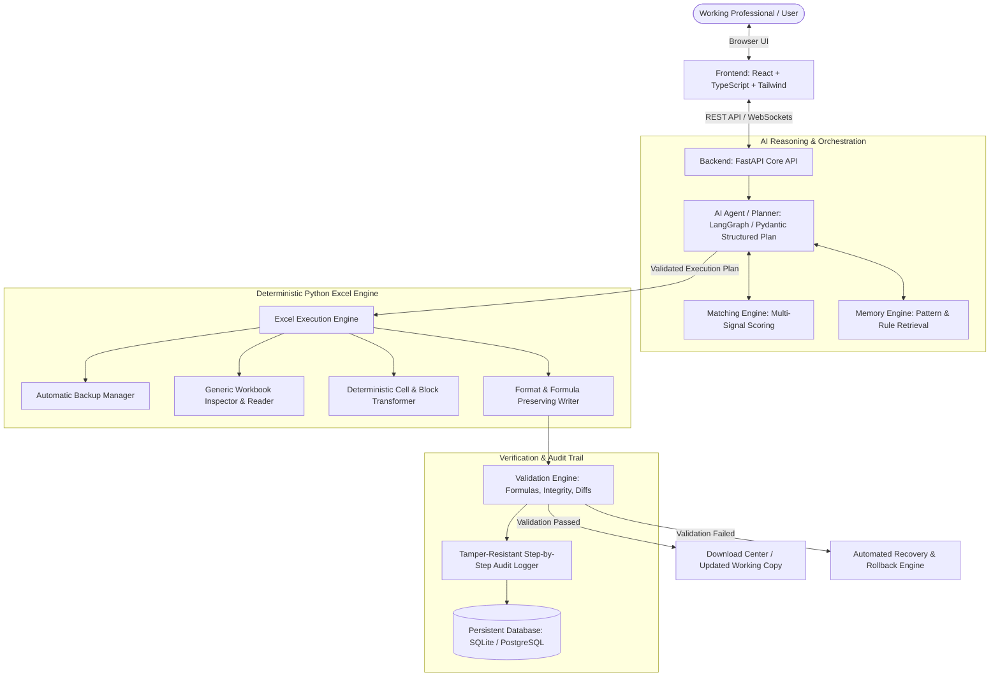

# ARCHITECTURE.md — Autonomous Excel Intelligence Platform

## 1. System Vision & Paradigm
The Autonomous Excel Intelligence Platform is a production-grade, enterprise-ready system designed to automate complex, multi-workbook Excel workflows without rigid hardcoding. 

### Core Architectural Philosophy
```
AI THINKS AND PLANS.
PYTHON DETERMINISTICALLY EXECUTES.
VALIDATION VERIFIES INTEGRITY.
MEMORY LEARNS APPROVED PATTERNS.
HUMAN APPROVES WHEN NECESSARY.
```

The system strictly avoids:
- Free-form LLM-generated code execution.
- Hardcoded cell positions, column names, employee IDs, or company-specific templates.
- Destructive in-place writes to source workbooks.
- Silent assumption of ambiguous entity or schema matches.

---

## 2. Global Architecture & Communication Flow



---

## 3. Fixed Project Structure & Module Responsibilities

```
autonomous-excel-intelligence/
├── frontend/                  # React + TypeScript + Tailwind SPA
│   ├── src/
│   │   ├── components/        # Reusable UI components (data grids, status badges, diff viewers)
│   │   ├── pages/             # Route pages: Dashboard, Task, Intelligence, Mapping, Audit
│   │   ├── layouts/           # App navigation & responsive shell
│   │   ├── hooks/             # Custom state & WebSocket polling hooks
│   │   ├── services/          # Typed API client calling FastAPI endpoints
│   │   ├── types/             # TypeScript interfaces mirroring backend Pydantic schemas
│   │   └── utils/             # Formatters, color scales, string helpers
│   ├── public/
│   ├── package.json
│   └── tsconfig.json
│
├── backend/                   # FastAPI Web Application & API Layer
│   └── app/
│       ├── api/               # API endpoints (upload, analyze, plan, approve, execute, audit)
│       ├── core/              # Config, security, exceptions, dependency injection
│       ├── middleware/        # Logging, rate-limiting, CORS, error interceptors
│       ├── schemas/           # Pydantic request/response models
│       ├── services/          # Coordination services linking AI, Excel, and Memory
│       └── main.py            # FastAPI ASGI entrypoint
│
├── ai_engine/                 # AI Reasoning, Planning & Decision Architecture
│   ├── agents/                # Agent definitions with bounded execution scopes
│   ├── planners/              # Structured execution plan generator (Pydantic models)
│   ├── reasoning/             # Decision rationalizer, confidence calculator, human escalation logic
│   ├── tools/                 # Bounded tool registry (deterministic schema inspectors, mappers)
│   ├── prompts/               # Versioned prompt templates
│   └── orchestration/         # State graph / workflow orchestration
│
├── excel_engine/              # Deterministic Python Processing Layer
│   ├── readers/               # Fast, generic OpenPyXL/zipfile workbook parser
│   ├── writers/               # Non-destructive working-copy writer preserving formulas & styles
│   ├── analyzers/             # Structural, header, merged-cell, and data-type detector
│   ├── mappers/               # Schema mapping, row alignment, block transform executor
│   ├── validators/            # Pre- and post-write formula, dimension, and type validator
│   ├── formulas/              # Dependency graph analyzer & formula expression protector
│   └── transformations/       # Clean, deterministic data transformations (dates, floats, strings)
│
├── memory/                    # Self-Learning & Experience Memory
│   ├── retrieval/             # Structural signature matcher & rule similarity search
│   ├── learning/              # Approved mapping recorder & pattern extractor
│   ├── workflows/             # Serialized workflow definitions
│   └── rules/                 # Versioned business rules with revoke & audit lifecycle
│
├── database/                  # Persistence Layer
│   ├── models/                # SQLAlchemy / SQLModel models (Tasks, Logs, Rules, Plans)
│   ├── repositories/          # Type-safe data access repositories
│   └── migrations/            # Database schema migration scripts
│
├── shared/                    # Code & Schemas Shared Across Modules
│   ├── schemas/               # Common data transfer objects
│   ├── enums/                 # ExecutionMode, TaskStatus, MatchConfidence, AuditSeverity
│   └── constants/             # Default thresholds, error codes, limits
│
├── tests/                     # Automated Test Suites
│   ├── unit/                  # Tests for analyzers, mappers, scoring, validators
│   ├── integration/           # Multi-step pipeline tests (upload -> match -> execute -> audit)
│   ├── end_to_end/            # API-level workflows
│   └── fixtures/              # Immutable test workbooks and synthetic variants
│
├── docs/                      # Authoritative Technical Documentation
│   ├── architecture/          # Architectural blueprints and diagrams
│   ├── api/                   # OpenAPI specifications and endpoint docs
│   ├── development/           # Setup, contributing, testing guides
│   └── decisions/             # Architecture Decision Records (ADRs)
│
├── storage/                   # Isolated Runtime Storage (Git Ignored)
│   ├── uploads/               # Staged raw input files
│   ├── processed/             # Final generated workbooks
│   ├── backups/               # Timestamped immutable backups of Master workbooks
│   ├── logs/                  # File-based structured execution logs
│   └── temporary/             # Scratch work-copies during validation
│
├── config/                    # Global app configuration & profiles
├── README.md                  # Project overview & quickstart
├── ARCHITECTURE.md            # Authoritative architecture specification (this file)
├── CHANGELOG.md               # Version history and milestone tracking
├── .env.example               # Environment variables template
└── .gitignore                 # Strict ignore rules
```

---

## 4. Generic Excel Intelligence Engine Principles

### 4.1 Structural Fingerprinting & Table Discovery
The system treats every worksheet as a spatial matrix:
1. **Scan Header Boundaries**: Calculates text density, string types, and header tokens without assuming Row 1 or Row 5.
2. **Metadata vs. Tabular Segmentation**: Detects key-value header blocks (e.g. `EMP. NAME: ...`, `Date: ...`) vs rectangular record grids.
3. **Formula Shielding**: Marks every cell containing an XML formula tag (`<f>`) as read-only by default unless explicitly designated as a re-evaluated target.
4. **Pre-allocated Slot Detection**: Discovers pre-populated formula rows (e.g. Master sheets where rows 6-25 already contain calculation formulas waiting for input data) and preserves formula integrity while inserting values.

### 4.2 Multi-Signal Intelligent Matching Engine
Matching entities (such as people, accounts, products, or departments) across disparate workbooks operates via weighted composite scoring:
- **Strong Identifier Signal (Weight 0.50)**: Exact token match (e.g., Employee ID, Tax ID, Account No).
- **Name / String Similarity Signal (Weight 0.30)**: Normalized Levenshtein / Jaro-Winkler ratio, accounting for honorifics, initials, and nickname aliases.
- **Contextual / Organizational Signal (Weight 0.20)**: Supervisor/TL matching, department headers, product targets, designation alignment.

Decision Matrix:
- `Score >= 0.90`: **High Confidence**. Proposed automatically; auto-executable in Autonomous Mode.
- `0.70 <= Score < 0.90`: **Medium Confidence**. Requires human approval in Supervised Mode.
- `Score < 0.70`: **Low Confidence**. Halts execution and presents multi-choice UI to user.

### 4.3 Safe Two-Phase Execution with Rollback
1. Original Master Workbook is copied to `storage/backups/<task_id>_backup.xlsx` with SHA-256 hash recorded.
2. Changes are executed on an isolated working copy in `storage/temporary/`.
3. Validation Engine validates cell formulas, circular dependencies, type parity, and total calculations.
4. Only upon 100% validation success is the working copy promoted to `storage/processed/`.
5. Rollback can be triggered anytime via the UI or automatically upon validation failure.

